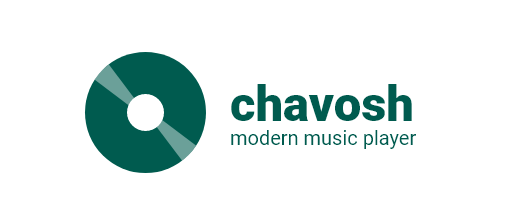

<div align="center">




# Chavosh (چاووش)
### Modern, Ultra-Smooth Desktop Audio Player Built with Tauri v2, Rust & Sarv UI

[](https://github.com/mjb4khshi/chavosh/releases/latest)
[](https://tauri.app/)
[](https://react.dev/)
[](https://www.typescriptlang.org/)
[](https://www.rust-lang.org/)
[](https://github.com/mjb4khshi/chavosh)
[](LICENSE)

<p align="center">
  <b>A state-of-the-art desktop music player blending vintage vinyl aesthetics with futuristic mini widgets, live karaoke synced lyrics, and high-performance native audio playback.</b>
  <br><br>
  <a href="#-quick-download-windows"><b>Quick Download</b></a> •
  <a href="#-key-features"><b>Features</b></a> •
  <a href="#-five-distinct-listening-modes"><b>Player Modes</b></a> •
  <a href="#-keyboard-shortcuts"><b>Shortcuts</b></a> •
  <a href="#-getting-started"><b>Development</b></a> •
  <a href="./README_FA.md"><b>🇮🇷 نسخه فارسی (Persian Docs)</b></a>
</p>

</div>

---

## ⚡ Quick Download (Windows x64)

| Package | Type | Download Link |
| :--- | :--- | :--- |
| **Windows Setup Installer** *(Recommended)* | `.exe` Setup | [**Download Chavosh_1.0.0_x64-setup.exe**](https://github.com/mjb4khshi/chavosh/releases/download/v1.0.0/Chavosh_1.0.0_x64-setup.exe) |
| **Windows MSI Package** | `.msi` Windows Installer | [**Download Chavosh_1.0.0_x64_en-US.msi**](https://github.com/mjb4khshi/chavosh/releases/download/v1.0.0/Chavosh_1.0.0_x64_en-US.msi) |
| **All Releases & Source** | GitHub Release Assets | [**View Latest Releases**](https://github.com/mjb4khshi/chavosh/releases/latest) |

---

## ✨ Key Features

- 🎙️ **Synchronized Karaoke Lyrics**: Live `.lrc` lyrics parsing, embedded tag extraction (`ID3v2`, `Vorbis`, `FLAC`), automatic search across LRCLIB and YouTube Captions, depth-of-field active line highlighting, and smooth auto-scrolling.
- 🌊 **Audiophile Liquid Wave Equalizer**: Dynamic 64-band FFT undulating wave ribbon closely hugging the vinyl rim, dynamically synchronized with the album artwork palette.
- ⚡ **Kick Transient Beat Pulse**: Intelligent transient flux onset detection delivering an authentic speaker-cone thump on drum kicks with clean rest recovery.
- 🎚️ **Dual-Deck Gapless Crossfade**: Two independent audio decks delivering gapless playback and automated DJ-grade crossfading between songs.
- 📀 **Authentic Vinyl & CD Physics**: Real turntable tonearm animation, spinning vinyl grooves, and iridescent CD rainbow reflections.
- 🎯 **5 Versatile Player Modes**: Seamlessly switch between a full desktop collection browser, immersive Vinyl Room, floating desktop gramophone widget, Dynamic Island capsule, and compact mini player.
- 🎨 **Sarv UI 0.3.1 Design System**: Handcrafted glassmorphic components, frosted glass blur, and 8 curated color themes.
- 🔊 **Dynamic Iconsax Volume**: Authentic linear iconography with live wave counts adapting to volume levels.
- 🔍 **Instant Fuzzy Search & Hotkeys**: Ultra-fast bilingual (Persian & English) search (`Ctrl + K`).

---

## 🎛️ Five Distinct Listening Modes

| Mode | Window Size | Description |
| :--- | :--- | :--- |
| **1. Desktop Library** | `1180 × 780` | Complete collection browser with Bento statistics, album covers, playlists, search, queue drawer, and lyrics. |
| **2. Vinyl Room** | Overlay | Fullscreen 3D-inspired turntable experience with spinning grooves, tonearm physics, liquid wave equalizer, and synchronized lyrics. |
| **3. Gramophone Widget** | Floating | Transparent desktop vinyl widget with size scaling (80%–130%), color matching, hover controls, and popover volume slider. |
| **4. Dynamic Island** | `356 × 48` | Nano capsule with live 3-bar animated EQ, scrolling ticker, hairline progress bar, and micro playback controls. |
| **5. Compact Mini Player** | `416 × 106` | Card player with ambient artwork backlight glow, inline volume slider, and timeline scrubber. |

---

## 🎨 Themes & Design Tokens (Sarv UI)

Chavosh includes **8 curated color themes**:
- 🌌 **Chavosh Dark** *(Default Deep Indigo)*
- 🌊 **Midnight Abyss** *(Pure OLED Blue-Black)*
- 🌲 **Emerald Woods** *(Rich Forest Mint)*
- 🌹 **Ruby Rose** *(Warm Crimson Velvet)*
- 🌅 **Sunset Horizon** *(Vibrant Twilight Amber)*
- ⚡ **Cyberpunk Neon** *(Electric Purple & Cyan)*
- ☀️ **Clean Light** *(Crisp Modern Daylight)*
- 🏛️ **Porcelain Studio** *(Warm Minimalist White)*

---

## ⌨️ Keyboard Shortcuts

| Shortcut | Action | Description |
| :--- | :--- | :--- |
| <kbd>Space</kbd> | Play / Pause | Toggle track playback state |
| <kbd>→</kbd> / <kbd>MediaNext</kbd> | Next Track | Skip to next queue item |
| <kbd>←</kbd> / <kbd>MediaPrev</kbd> | Previous Track | Skip to previous track |
| <kbd>↑</kbd> / <kbd>↓</kbd> | Volume Up / Down | Adjust volume in 5% increments |
| <kbd>M</kbd> | Toggle Mute | Instant mute with linear Iconsax icon |
| <kbd>Ctrl</kbd> + <kbd>K</kbd> | Instant Search Bar | Focus search input in library |
| <kbd>Ctrl</kbd> + <kbd>L</kbd> | Toggle Lyrics | Open/close synchronized karaoke lyrics |
| <kbd>P</kbd> | Pin Window | Toggle Always on Top |
| <kbd>Esc</kbd> | Exit Room / Overlay | Return to desktop library view |

---

## 🚀 Getting Started

### Prerequisites
- [Node.js](https://nodejs.org/) (v18 or higher)
- [Rust & Cargo](https://rustup.rs/) (latest stable)

### Development
```bash
# Clone the repository
git clone https://github.com/mjb4khshi/chavosh.git
cd chavosh

# Install dependencies
npm install

# Run in desktop development mode (Tauri v2 + Vite)
npm run tauri dev
```

### Production Build
```bash
# Compile standalone release binary
npm run tauri build -- --no-bundle
```

---

## 📄 License

This project is open-source under the [MIT License](LICENSE).  
Developed with ❤️ by [MJ Bakhshi](https://github.com/mjb4khshi).
